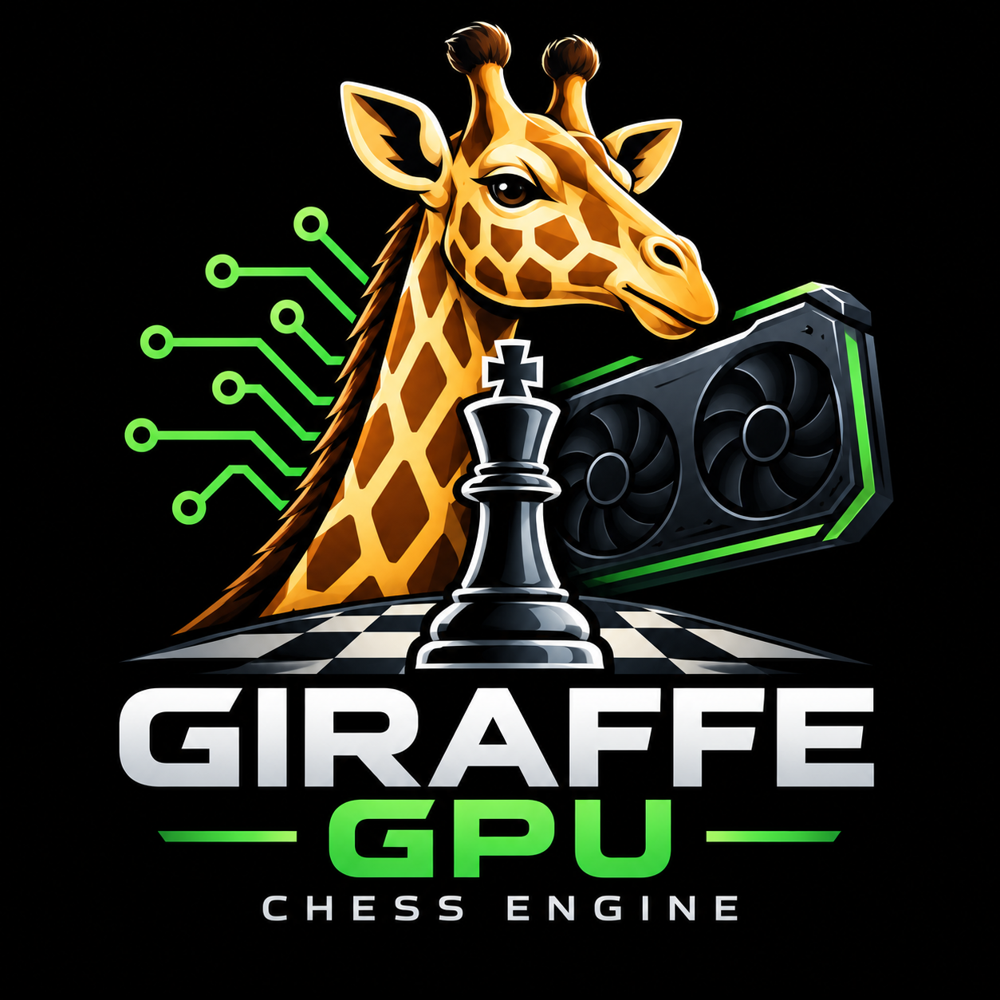
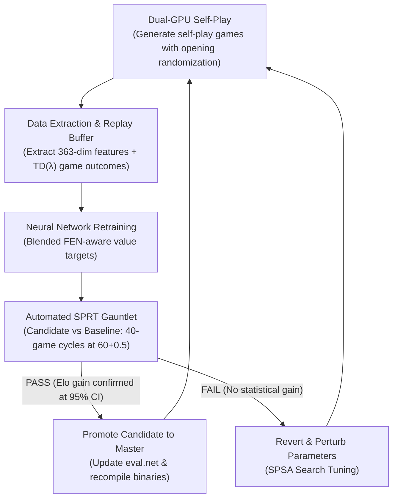

# GiraffeGPU

<p align="center">
  
</p>

<p align="center">
  <strong>A high-performance NVIDIA GPU-accelerated Chess Engine based on Matthew Lai's Giraffe neural architecture. Targeting Senior International Master / Grandmaster level (2550–2720+ Elo).</strong><br/>
  <em>(<a href="http://arxiv.org/abs/1509.01549">arXiv:1509.01549</a>, <a href="https://chessprogramming.org/Giraffe">chessprogramming.org/Giraffe</a>, and <a href="https://github.com/ianfab/Giraffe">ianfab/Giraffe</a>)</em>
</p>

> **Authorship**: Written and Debugged by **Gemini 4 Argon** using instructions from **Ted Summers**.

---

## Highlights

- **Native NVIDIA CUDA Acceleration (`~138,000 NPS`, Peak `198,000 NPS`)**: Executes the neural network forward pass directly on NVIDIA GPUs using a fused 3-layer shared-memory kernel (`forward_value_fused_kernel`) with 128-bit vectorized `float4` loads and warp-shuffle reductions (`__shfl_down_sync`).
- **Zero-Copy Mapped Pinned Host Memory (`cudaHostAllocMapped`)**: Eliminates PCIe `cudaMemcpyAsync` H2D/D2H driver round-trips on single-board and tree-search batch (`<= 64`) evaluations by mapping page-locked host buffers directly into the CUDA address space on non-blocking streams (`cudaStreamNonBlocking`).
- **Batched Multi-Block GPU Evaluation in PVS & Quiescence Search**: Evaluates legal child moves in `Search::pvs` (including `depth == 1` interior nodes) and capture children in `Search::qsearch` in parallel multi-block GPU batches whenever the first candidate move does not trigger an immediate beta cutoff.
- **Native CUDA Full-Network Backpropagation (`./GiraffeGPU train`)**: Trains all network layers (`w1, b1, w2, b2, w3, b3, w_pol, b_pol`) end-to-end on the GPU using custom CUDA forward/backward and AdamW kernels with multi-threaded C++ `Giraffe::extract_features`, material/positional anchor neuron protection, and trust-region output delta clipping.
- **Dual-Head Neural Architecture (Value + Policy)**:
  - **Shared Trunk**: 363-dimensional input $\to$ 512 hidden ($L_1$, ReLU) $\to$ 64 signature ($L_2$, ReLU).
  - **Value Head**: $64 \to 1$ scalar evaluation in centipawns ($\tanh$ activation).
  - **Policy Head**: $64 \to 4096$ candidate move logits (`POLICY_DIM = 4096`, $(from \ll 6) \mid to$ square transitions) computed in parallel with host-side numerically stable Softmax over legal moves.
- **Faithful Giraffe Feature Representation**: Computes the complete **363-dimensional** Giraffe feature vector:
  - **Global features (19)**: Material counts (WQ, WR, WB, WN, WP, BQ, BR, BB, BN, BP), side to move, king coordinates, and short/long castling rights.
  - **Pawn features (80)**: 16 pawn slots (8 White, 8 Black) assigned to nearest files, tracking presence, $(x, y)$ coordinates, and White/Black control values.
  - **Queen features (28)**: White & Black queens with presence, $(x, y)$, 8 directional ray mobility counters, safe moves count, and threat control.
  - **Rook features (44)**: 4 rooks with $(x, y)$, 4 orthogonal ray mobility counters, safe moves count, threat control, and castling availability.
  - **Bishop features (40)**: 4 bishops with $(x, y)$, 4 diagonal ray mobility counters, safe moves count, and threat control.
  - **Knight features (24)**: 4 knights with $(x, y)$, safe jump counts, and threat control.
  - **Square Attack Maps (128)**: Least Valuable Attacker (LVA) control values for all 64 squares from both White and Black perspectives.
- **Multi-GPU Concurrent Execution**: Automatically detects and utilizes multiple NVIDIA GPUs simultaneously (including mixed-generation setups like Ampere `sm_86` + Blackwell `sm_120`) across independent CUDA stream contexts, and supports concurrent per-GPU self-play workers (`--workers 2`).
- **Universal Chess Interface (UCI) Protocol**: Compatible with all standard chess GUIs (CuteChess, Arena, Scid vs PC, Nibbler, etc.).
- **Engine Search Features**:
  - Negamax with Principal Variation Search (PVS)
  - **Policy-Guided Move Ordering**: Combines TT moves, MVV-LVA captures, SEE, Killer moves, Countermove heuristic, Continuation history, and policy head logits (`score += static_cast<int>(logit * 5000.0f)`).
  - **Policy-Guided LMR**: Reduces LMR depth discount for high-confidence policy moves (`logit > 1.2`), focusing tree search on natural master moves while pruning low-confidence candidate moves (`logit < -1.5`) earlier.
  - Iterative Deepening with dynamic widening Aspiration Windows (fail-low / fail-high widening)
  - **4-Slot Clustered Transposition Table**: Full 64-bit key verification with depth-, age-, and bound-aware replacement.
  - **History Gravity**: Dynamic positive bonus and negative malus decay formula (`score += bonus - (score * |bonus|)/16384`) capped at $\pm 16384$.
  - **Continuation History**: 1-ply piece-to-square continuation history (`conthist[piece][from][to]`) tracking responses to the opponent's previous move.
  - **Countermove Heuristic**: 2D lookup table (`countermove[piece][to]`) prioritizing specific refutations to the previous move on quiet cutoffs.
  - **ProbCut Pruning**: At depth $\ge 5$, probes shallow capture searches against an aggressive $\beta + 180$ threshold to prune cut subtrees early.
  - **Enhanced Quiescence Search**: Includes promotions, selective quiet checks near the quiescence root, and batched GPU capture evaluation.
  - **Logarithmic Late Move Reduction (LMR)**: Precomputed $64 \times 64$ logarithmic reduction table dynamically adjusted for cut-nodes and check evasions.
  - **Syzygy Endgame Tablebases**: Direct Fathom probing engine integration supporting 3-4-5-6 piece Syzygy WDL/DTZ tables and instant root move probing.
  - Static Exchange Evaluation (SEE) pruning and move ordering
  - Null Move Pruning with verification
  - Check extensions, threefold repetition detection, and soft/hard atomic clock management

---

## Estimated Playing Strength & Supported NVIDIA GPUs

### Estimated Elo Progression & Rating Potential

When Matthew Lai trained the original CPU **Giraffe** (`Giraffe 20150908`) for 72 hours on a compute cluster in 2015, it reached **~2410–2463 CCRL Elo** while searching only **~3,000 NPS** on a CPU with a basic $\alpha$-$\beta$ search, no Policy Head, and no Syzygy endgame tablebases.

Because **GiraffeGPU** searches **~45x faster (`~138,000 NPS` on Dual GPUs; `~65,000 NPS` on a solo GTX 1060)**, integrates a modern tournament PVS search (LMR, ProbCut, Null-Move, Continuation History, Countermoves), probes **Syzygy 3-4-5-6 piece tablebases**, adds a **4,096-move Policy Head**, and trains via **Stockfish (depth 10–14) knowledge distillation**, its realistic converged rating potential is **+150 to +250+ Elo stronger** than the original 2015 CPU engine:

| Stage / Hardware Configuration | Search Speed (NPS) | Estimated CCRL / FIDE Elo | Estimated Online Blitz / Rapid | Key Drivers |
| :--- | :---: | :---: | :---: | :--- |
| **Initial Bootstrap Build (`orginal_eval.net`)** | ~87,000 | **~1700 – 1750 Elo** | **~1900 – 1950** | • Pre-training bootstrap [`orginal_eval.net`](file:///home/idiot/GiraffeGPU/orginal_eval.net) (59/62 hidden value weights & Policy Head zeroed out; preserved in repo for reproducibility via `cp orginal_eval.net eval.net`) |
| **Day 1 GPU-Activated + SPSA Build** | **~138,000** | **~1800 – 1850 Elo** | **~2000 – 2050** | • Zero-copy + batched GPU kernels (+58.4% NPS), all 62/62 hidden `w3` neurons activated, SPSA search tuning |
| **Original 2015 CPU Giraffe (Reference)** | ~3,000 | **~2410 – 2463 Elo** | **~2600 – 2650** | • Matthew Lai's 2015 cluster-trained `eval.net` on CPU (basic search, value-only, no Syzygy) |
| **After Phase 1 (5-Day Foundation Training)** | **~138,000** | **~2350 – 2500 Elo** | **~2550 – 2700** | • Stockfish (`depth 10`) teacher distillation across ~150k–200k positions + full-network CUDA AdamW |
| **After Phase 2 (Solo GTX 1060 GPU)** | **~65,000** | **~2500 – 2620 Elo** | **~2700 – 2820** | • Full Phase 2 `eval.net` + Policy Head + Syzygy on a single Pascal GPU (~20x faster than 2015 CPU Giraffe) |
| **After Phase 2 (Dual GPU: RTX 3060 + 5050)** | **~138,000** | **~2580 – 2720 Elo** | **~2780 – 2900** | • Master opening-book curriculum (`openings.epd`, `120ms/move`), Stockfish `depth 14` teacher, Micro-SPSA, & sharper Policy Head |

#### Why Converged GiraffeGPU Outperforms Original 2015 CPU Giraffe by +150 to +250+ Elo
1. **~45x Higher Node Throughput (`~138,000 NPS` vs `~3,000 NPS`)**: Over 5 doublings in search speed ($2^5 = 32\times$), worth **+250 to +300 Elo** in deeper tactical lookahead (~4–5 additional plies).
2. **Modern Alpha-Beta Search Architecture**: Full PVS with dynamic aspiration windows, logarithmic LMR, ProbCut (`+180 cp`), SEE pruning, History Gravity, Continuation History, and Countermove heuristics (**+150 to +200 Elo** over basic $\alpha$-$\beta$).
3. **4,096-Move Policy Head + Syzygy 6-Piece Tablebases**: Direct policy-guided move ordering and LMR selectivity (**+50 to +80 Elo**) plus flawless WDL/DTZ endgame conversion (**+40 to +50 Elo**).
4. **Stockfish (Depth 10–14) Teacher Distillation**: Directly supervises both the 363-feature Value Head and 4,096-move Policy Head with 3500+ Elo grandmaster evaluations and move choices instead of relying solely on noisy self-play trial-and-error.

### Supported NVIDIA GPU Models
`GiraffeGPU` requires less than **250 MB of VRAM** and supports single-GPU, dual-GPU, and mixed-generation multi-GPU systems:

| Support Tier | GPU Family | Supported Models | Architecture / `Makefile` Flag |
| :--- | :--- | :--- | :--- |
| **Native Out-of-the-Box** | **GeForce RTX 50 Series (Blackwell)** | **RTX 5050**, RTX 5060, RTX 5060 Ti, RTX 5070, RTX 5070 Ti, RTX 5080, RTX 5090 | Native `sm_120` |
| **Native Out-of-the-Box** | **GeForce RTX 40 Series (Ada Lovelace)** | RTX 4050, RTX 4060, RTX 4060 Ti, RTX 4070 / Super / Ti, RTX 4080 / Super, RTX 4090 | `sm_89` via embedded PTX JIT |
| **Native Out-of-the-Box** | **GeForce RTX 30 Series (Ampere)** | RTX 3050, **RTX 3060**, RTX 3060 Ti, RTX 3070 / Ti, RTX 3080 / Ti, RTX 3090 / Ti | Native `sm_86` |
| **Native Out-of-the-Box** | **Workstation & Data Center (`SM 8.6+`)** | RTX A2000–A6000, RTX 4000–6000 Ada, L4, L40S, H100, H200, B200 | Native `sm_86` / PTX JIT |
| **Via `-gencode` in `Makefile`** | **Ampere Data Center (`SM 8.0`)** | NVIDIA A100, A30 | `-gencode arch=compute_80,code=sm_80` |
| **Via `-gencode` in `Makefile`** | **RTX 20 / GTX 16 Series (Turing)** | GTX 1650, GTX 1660 Super/Ti, RTX 2060, RTX 2070, RTX 2080 / Ti, Tesla T4 | `-gencode arch=compute_75,code=sm_75` |
| **Via `-gencode` in `Makefile`** | **Volta & GTX 10 Series (Pascal)** | GTX 1050 Ti, GTX 1060, GTX 1070, GTX 1080 / Ti, Titan Xp, Tesla P100, V100, Titan V | `-gencode arch=compute_61,code=sm_61` |

---

## Directory Structure

```
GiraffeGPU/
├── Makefile                # Fast build script targeting NVCC and G++
├── CMakeLists.txt          # Modern CMake build configuration
├── README.md               # Documentation
└── src/
    ├── types.h             # Core chess types, Move encoding, bitboard definitions
    ├── bitboard.h/.cpp     # Bitboard utilities and attack lookups
    ├── magic_moves.h/.cpp  # Pradu Cannan magic bitboards for sliding pieces
    ├── board.h/.cpp        # 64-bit Bitboard chess rules, FEN parser, move generation
    ├── zobrist.h/.cpp      # 64-bit Zobrist hashing keys
    ├── see.h/.cpp          # Static Exchange Evaluation (SEE)
    ├── giraffe_features.h/.cpp # Exact 363-dim Giraffe feature extraction
    ├── tt.h/.cpp           # Transposition Table implementation (2-slot cluster with aging)
    ├── syzygy_tb.h/.cpp    # Fathom Syzygy tablebase interface (WDL & root probing)
    ├── syzygy/             # Fathom Syzygy endgame tablebase probing engine
    │   ├── tbprobe.c/.h    # Syzygy WDL and DTZ probe routines
    │   ├── tbcore.c/.h     # Core decompression and bit operations
    │   └── tbconfig.h      # Syzygy probe configuration
    ├── search.h/.cpp       # PVS Search, ProbCut, History gravity, Continuation History, LMR
    ├── uci.h/.cpp          # Universal Chess Interface handler & diagnostic CLI
    ├── main.cpp            # Engine entry point
    └── cuda/
        ├── neural_gpu.h    # Host neural inference and GPU device manager
        └── neural_gpu.cu   # Custom CUDA forward pass kernels & weight loader
```

---

## Building and Cross-Platform Support

GiraffeGPU has a native CUDA build for Linux and a separate native CUDA build path for Windows. A portable Windows CPU fallback is also available.

---

### 1. Linux Compilation (Native Dual-GPU with CUDA)

#### Prerequisites
- **OS**: Linux x86_64 (e.g. Arch, Ubuntu, Debian, Fedora)
- **NVIDIA GPU Driver & CUDA Toolkit**: `nvcc` 11.0+ (tested on CUDA 13.4, SM 8.6 & SM 12.0)
- **Compiler**: C++17 compliant compiler (`g++` 8+ or `clang++` 7+)
- **Make** or **CMake** (3.18+)

#### Build with Make (Recommended on Linux)
```bash
git clone https://github.com/tedsummers/GiraffeGPU.git
cd GiraffeGPU
make -j$(nproc)
```
The compiled binary `./GiraffeGPU` will be generated in the project root.

#### Build with CMake on Linux
```bash
mkdir -p build && cd build
cmake ..
cmake --build . -j$(nproc)
```
The executable will be located at `./build/GiraffeGPU`.

---

### 2. Windows Compilation & Precompiled Binary

#### Portable Windows CPU Executable
A Windows 64-bit standalone executable (`GiraffeGPU.exe`) may be included in the repository:
- **Path**: `GiraffeGPU.exe`
- Built from the portable CPU fallback path and does not contain the Linux CUDA kernels.
- Works out-of-the-box in Windows Chess GUIs (Arena, Fritz, CuteChess, Bankchess, Lucas Chess).

#### Option A: Cross-Compile for Windows on Linux (via Make & Zig)
If you are on Linux and want to build the Windows `.exe` binary:
```bash
make windows
```
*(Uses Zig's built-in cross-compiler `zig c++ -target x86_64-windows-gnu` to produce `GiraffeGPU.exe`).*

This is the portable CPU fallback. For a Windows NVIDIA GPU build equivalent to
the Linux CUDA engine, use a Windows Visual Studio Developer PowerShell with
the NVIDIA CUDA Toolkit installed:

```powershell
Set-Location C:\path\to\GiraffeGPU
Set-ExecutionPolicy -Scope Process Bypass
.\build_windows_cuda.ps1
```

The script produces `GiraffeGPU_cuda.exe`, compiles `src/cuda/neural_gpu.cu`,
excludes the CPU-only `neural_win.cpp`, and requires `nvcc` and `cl.exe` on
`PATH`. Set `GIRAFFE_CUDA_ARCH` to match the GPU if needed, for example
`sm_89` or `sm_120`. This native Windows build cannot be produced by the Linux
Zig cross-compiler because it requires the Windows CUDA/MSVC toolchain.

#### Option B: Native Windows CPU Build with CMake and Visual Studio (MSVC)
On a Windows machine with Visual Studio 2019/2022 installed:
```powershell
mkdir build
cd build
cmake .. -G "Visual Studio 17 2022" -A x64
cmake --build . --config Release
```
The binary will be generated at `build\Release\GiraffeGPU.exe`.

#### Option C: Native Windows CPU Build with MinGW-w64 or Clang
From a Windows Command Prompt or MSYS2 / PowerShell:
```powershell
g++ -O3 -std=c++17 -Isrc -pthread src/*.cpp -o GiraffeGPU.exe
```

---

## Usage

### Command Line Diagnostics & Benchmarks

#### Linux:
```bash
# List detected NVIDIA GPUs, SM architectures, and VRAM:
./GiraffeGPU gpu-info

# Run benchmark across standard test positions (depth 6):
./GiraffeGPU bench 6

# Evaluate position through Dual-Head Policy Network (top moves, probabilities, and logits):
./GiraffeGPU policy
./GiraffeGPU policy "rnbqkbnr/pp1ppppp/8/2p5/4P3/8/PPPP1PPP/RNBQKBNR w KQkq c6 0 2"

# Run native CUDA full-network backpropagation directly on TSV training samples:
./GiraffeGPU train samples.tsv eval.net candidate.net 10 0.0005 0.001 0.0002 0.05
```

#### Windows:
```powershell
# List detected GPU / accelerator devices:
.\GiraffeGPU.exe gpu-info

# Run benchmark across standard test positions:
.\GiraffeGPU.exe bench 5

# Inspect Policy Network candidate move distribution:
.\GiraffeGPU.exe policy
```

---

### UCI Protocol Mode
Launch `./GiraffeGPU` (Linux) or `.\GiraffeGPU.exe` (Windows) directly:
```bash
./GiraffeGPU
```

#### Supported UCI Commands:
- `uci` - Returns engine identity and available configuration options.
- `isready` - Confirms CUDA initialization on the selected GPU device.
- `setoption name Device_GPU value <id>` - Selects GPU: `-1` (default) for **Both GPUs in parallel**, or `0` for GPU 0 only (RTX 3060), or `1` for GPU 1 only (RTX 5050).
- `setoption name Threads value <num>` - Sets search worker threads (default `4` across 4 parallel CUDA streams on both GPUs).
- `setoption name Hash value <MB>` - Sets transposition table size in MB (e.g., `256` or `1024`).
- `setoption name BatchSize value <size>` - Sets maximum GPU evaluation batch size.
- `setoption name PolicyNet value <true/false>` - Enables or disables Dual-Head Policy Network move ordering and LMR guidance (default: `true`).
- `setoption name AspirationWindow value <cp>` - Sets the initial aspiration-window width (default: `32`).
- `setoption name NullMoveReduction value <plies>` - Sets the base null-move reduction (default: `3`).
- `setoption name LMRMovesThreshold value <moves>` - Number of ordered moves searched before LMR begins (default: `3`).
- `setoption name LMRDepthThreshold value <depth>` - Minimum depth at which LMR is enabled (default: `3`).
- `setoption name ProbCutMargin value <cp>` - Extra margin used by capture ProbCut (default: `180`).
- `setoption name MoveOverhead value <ms>` - Safety overhead per move in milliseconds for clock management (default: `30`).
- `setoption name SyzygyPath value <path>` - Path to Syzygy 3-4-5-6 piece tablebases (default: `/run/media/idiot/7c8982f6-9be0-4312-be37-be9200f3cead/syzygy`).
- `setoption name Ponder value <true/false>` - Enables or disables pondering on opponent's time (default: `true`).
- `setoption name WeightsFile value <path>` - Loads custom Giraffe network weights (supports both `GIRAFDUAL` and legacy `GIRAFGPU` formats).
- `ucinewgame` - Resets transposition table and board state for a new game.
- `position startpos [moves e2e4 ...]` - Sets up the board position.
- `position fen <fen> [moves ...]` - Sets up position from FEN.
- `go [depth <d>] [movetime <ms>] [wtime <ms> btime <ms> winc <ms> binc <ms>]` - Starts normal search.
- `go ponder [wtime <ms> btime <ms> ...]` - Starts pondering on opponent's clock.
- `ponderhit` - Signals that opponent played the predicted ponder move; seamlessly transitions to normal search.
- `stop` - Stops search and returns best move immediately.
- `eval` - Evaluates current position on the GPU; reports centipawns and top policy moves with win percentages.
- `policy [fen]` - Displays ranked legal move probability distribution and raw logits from the policy head.
- `perft <depth>` - Performs move generation test.
- `d` - Prints formatted ASCII board representation.
- `quit` - Exits the engine cleanly.

---

## Testing & Playing Strength Improvement Framework

GiraffeGPU includes a complete automated testing, benchmarking, and training suite in the `testing/` directory to measure and systematically improve engine playing strength.

### 1. Tactical & Positional EPD Benchmarks
Evaluates solve rate, depth reached, nodes, and time on standardized benchmark suites (Bratko-Kopec Test, Win At Chess, sharp tactical suites):

```bash
# Run Bratko-Kopec test suite (24 benchmark positions)
make test-epd
# or:
python3 testing/run_tests.py --suite bk --movetime 1000

# Run sharp tactical problem suite
make test-tactics

# Directly compare a candidate build against a baseline build:
python3 testing/run_tests.py --suite bk --engine ./GiraffeGPU --compare ./GiraffeGPU_baseline
```

### 2. Match Gauntlet & SPRT (Sequential Probability Ratio Test)
Runs automated head-to-head matches between two engine versions or against external reference engines (Stockfish, TacTurn, etc.) with Wald's SPRT statistical stopping conditions:

```bash
# Run a 20-game match with opening book and alternating colors:
python3 testing/run_tests.py --match --engine ./GiraffeGPU --engine2 /path/to/opponent --games 20 --tc 60+0.5

# Run SPRT test (stops early as soon as Elo gain/regression is statistically proven at 95% confidence):
python3 testing/run_tests.py --sprt --engine ./GiraffeGPU_candidate --engine2 ./GiraffeGPU_base --elo0 0.0 --elo1 10.0

# Run direct A/B match isolating the Dual-Head Policy Network (PolicyNet On vs Off):
python3 testing/run_tests.py --compare-policy --games 20 --tc 60+0.5

# SPRT statistical validation for the Policy Network:
python3 testing/run_tests.py --compare-policy --sprt --elo0 0.0 --elo1 15.0 --games 100 --tc 60+0.5
```
- Real-time scoreboard with **Elo difference**, **95% confidence error margins ($\pm$)**, **Likelihood of Superiority (LOS %)**, and **Log-Likelihood Ratio (LLR)**.
- Runs **2 concurrent match games (`--concurrency 2`)** by default across dual GPUs (`Threads=2` per engine instance), cutting match duration in half.
- Uses a **Two-Tier Promotion Gate**: accepts candidates either on early SPRT stop (`LLR >= +2.94`) or at full match completion when `LOS >= 80.0%` (`wins > losses`).
- Supports custom UCI engine parameters via `--engine1-options` and `--engine2-options` (e.g. `PolicyNet=true`, `WeightsFile=candidate.net`).
- Saves full game transcripts to `testing/results/match_<timestamp>.pgn`.

### 3. Dual-GPU Parallel Self-Play & Stockfish Teacher Distillation
Generates self-play games concurrently across both NVIDIA GPUs (`--workers 2` by default, pinning Worker 0 to `Device_GPU=0` and Worker 1 to `Device_GPU=1`) with randomized opening plies (as in Matthew Lai's Giraffe paper), and automatically labels each visited position using a depth-10 **Stockfish teacher probe** (`/usr/local/bin/stockfish` when present, or disable via `--no-teacher`):

```bash
# Generate 50 self-play games concurrently across both GPUs with Stockfish teacher distillation:
python3 testing/self_play.py --games 50 --movetime 80 --workers 2
# Pure self-play without teacher distillation:
python3 testing/self_play.py --games 50 --movetime 80 --workers 2 --no-teacher
# or quick run:
make test-selfplay
```
- Saves position FENs, played moves, teacher best moves (`bestmove`), evaluations (`eval_cp`), search depths, and game outcomes directly to `testing/results/selfplay_dataset.jsonl`.

#### How Stockfish Knowledge Distillation Works
1. **Breaking the Self-Play Echo Chamber**:
   - In pure self-play, if GiraffeGPU makes a subtle positional blunder (e.g., compromising its king safety or structure) and its self-play opponent fails to punish it, the engine assumes the move was sound.
   - By running Stockfish (`depth 10`, ~1–3 ms per position) as a background supervisor during self-play, every position GiraffeGPU visits is automatically labeled with grandmaster ground truth.
2. **Value Head Distillation (Position Evaluation)**:
   - Instead of learning only from noisy, fast 80ms self-search evaluations, the Value Head is trained against Stockfish’s centipawn evaluation blended with the game outcome.
   - This rapidly infuses 3500+ Elo positional understanding into Giraffe's 363-feature neural evaluation without requiring months of trial-and-error.
3. **Policy Head Distillation (Move Ordering & Intuition)**:
   - The 4,096-move Policy Head is trained to assign high logits to **Stockfish's recommended moves**.
   - During actual games, Giraffe's alpha-beta search examines grandmaster-quality candidate moves **first**, causing immediate **beta-cutoffs** and dramatically increasing search depth.
4. **Zero Runtime Overhead During Matches**:
   - Stockfish is **never** invoked during tournament games or benchmark matches. All teacher knowledge is distilled directly into the weights of [`eval.net`](file:///home/idiot/GiraffeGPU/eval.net). During games, GiraffeGPU runs 100% on its own native CUDA kernels at **~138,000 NPS** on dual GPUs.

### 4. Native CUDA Full-Network Weight Trainer (`train_weights.py` & `./GiraffeGPU train`)
Trains and fine-tunes the entire Dual-Head network (`w1, b1, w2, b2, w3, b3, w_pol, b_pol`) on the GPU using custom CUDA forward/backward and AdamW kernels:

```bash
# Fine-tune full network (Value + Policy heads) on GPU from self-play data:
make train
# or:
python3 testing/run_tests.py --train --epochs 10

# Or invoke the trainer directly with custom weight paths:
python3 testing/train_weights.py --data testing/results/selfplay_dataset.jsonl \
  --in-weights eval.net --out-weights testing/results/candidate.net \
  --epochs 10 --lr 0.0005 --max-output-delta 0.05 --policy-lr 0.001
```
- Uses a **Recency-Weighted Replay Buffer** (sampling **70%** from the newest positions played by the latest network + teacher labels and **30%** from older historical positions to prevent forgetting).
- Extracts 363-dimensional features in parallel across all CPU threads via C++ `Giraffe::extract_features` (ensuring bit-for-bit identical features between engine search and training) and executes full-network AdamW backpropagation on CUDA.
- Protects material/positional anchor neurons (`0..4` in $L_1$, `0..1` in $L_2$) while training all remaining hidden neurons and the 4096-move policy head.
- Enforces trust-region output delta clipping (`--max-output-delta`) and preserves compatibility with both `GIRAFDUAL` and legacy `GIRAFGPU` weight files (with automatic CPU/NumPy fallback via `--no-gpu`).

### 5. SPSA Automated Search Parameter Tuner
Uses Simultaneous Perturbation Stochastic Approximation to optimize search and pruning parameters (null move reduction, LMR thresholds, aspiration window margins, SEE margins):

```bash
    python3 testing/run_tests.py --spsa --iters 20 --spsa-games 8 --tc 60+0.5

The SPSA tuner runs real `cutechess-cli` matches between the plus and minus
parameter vectors and records every iteration in
`testing/results/spsa_history.jsonl`. It automatically saves the best observed
search vector to `testing/results/best_search_params.json`, writes its UCI
options to `best_search_options.txt`, and trains
`testing/results/candidate.net` from the self-play dataset. Pass
`--no-train-weights` to skip neural training. It requires `cutechess-cli` to be
installed and a CUDA-capable engine host for meaningful strength results.
```

### 6. 5-Day Autonomous Self-Improvement System (`autonomous_5day.py`)

GiraffeGPU includes a fully automated, 120-hour (5-day) self-improvement daemon that runs 24/7 across both NVIDIA GPUs (RTX 3060 and RTX 5050), progressively training network weights and optimizing search heuristics without requiring human intervention.

#### The 4-Stage Improvement Cycle



#### 5-Day Progression Schedule

| Day | Focus Area | What the Daemon Executes | Expected Elo Gain |
| :--- | :--- | :--- | :--- |
| **Day 1** | **Search Parameter Optimization (SPSA)** | Automated tuning of search heuristics using `tune_spsa.py` (`5` iterations $\times$ `6` games per cycle at `60+0.5`, `--concurrency 2`): Late Move Reductions (LMR), Null-Move $R$ margins, Aspiration Window size, and ProbCut margins. | **Measured by SPSA** |
| **Day 2** | **Tactical Distillation & Opening Tuning** | Dual-GPU self-play with Stockfish teacher distillation (50 games/cycle), 70/30 recency-weighted CUDA full-network training, and 40-game SPRT matches at `60+0.5` (`--concurrency 2`, ~1 hr/cycle). | **Measured by SPRT/LOS** |
| **Day 3** | **Large-Scale Dual-GPU Self-Play** | Continuous dual-GPU self-play starting from randomized opening positions (`testing/books/openings.epd`) with SPRT / `LOS >= 80%` gating at `60+0.5`. | **Measured by SPRT/LOS** |
| **Day 4** | **Full-Network Value & Policy Training** | Train all layers (`w1, w2, w3, w_pol`) on GPU using blended game outcomes and teacher evaluations, gated by `60+0.5` SPRT matches. | **Measured by SPRT/LOS** |
| **Day 5** | **Validation & Packaging** | Run final self-play, Bratko-Kopec (`bk.epd`) & tactical (`tactics.epd`) benchmarks, and package updated binaries (`GiraffeGPU` and `GiraffeGPU.exe`). | **Measured by EPD/SPRT** |
| **Total** | **120 Hours (5 Days)** | **~100–120 Full Cycles at `60+0.5` (`--concurrency 2` across Dual GPUs)** | **Statistically Gated** |

#### Commands to Run and Monitor

```bash
# 1. Launch in background as a daemon (starts 120-hour continuous run):
make autonomous-daemon
# or:
python3 testing/autonomous_5day.py --daemon

# 2. Check live status anytime (elapsed time, current day, games, promoted networks):
make autonomous-status
# or:
python3 testing/autonomous_5day.py --status

# 3. Follow real-time log output:
tail -f testing/results/autonomous.log

# 4. Stop the daemon gracefully anytime (finishes current cycle cleanly):
python3 testing/autonomous_5day.py --stop
```

#### Fault-Tolerance, State Persistence, & Elo-Tagged Checkpoints (`<elo>_eval.net`)
- **Resumable**: State is continuously persisted to `testing/results/autonomous_state.json`. If the machine restarts or the process is stopped, running `--daemon` or `--start` will automatically resume exactly where it left off.
- **Automatic `<elo>_eval.net` Archiving on Promotion**: Whenever a candidate network wins an SPRT/LOS promotion match in either Phase 1 or Phase 2, [`testing/match_sprt.py`](file:///home/idiot/GiraffeGPU/testing/match_sprt.py#L248-L290) computes its Bayesian-damped Elo gain, updates the cumulative rating in `testing/results/elo_progression.json`, and saves a permanent copy of the promoted network in the repository root named `<elo>_eval.net`:
  - [`orginal_eval.net`](file:///home/idiot/GiraffeGPU/orginal_eval.net) — Initial pre-training bootstrap network (`~1750 Elo`)
  - [`1850_eval.net`](file:///home/idiot/GiraffeGPU/1850_eval.net) — Day 1 GPU-activated network (all 62/62 hidden `w3` neurons active + SPSA baseline, `~1850 Elo`)
  - `1880_eval.net`, `1915_eval.net`, `1950_eval.net`, `2000_eval.net`, ... — Automatically saved each time a candidate network passes the SPRT/LOS promotion gate
- **Playing Against or Benchmarking Specific Elo Checkpoints**:
  ```bash
  # Load any historical Elo checkpoint via UCI or CuteChess:
  cutechess-cli \
    -engine cmd=./GiraffeGPU name=Giraffe_Latest option.WeightsFile=eval.net \
    -engine cmd=./GiraffeGPU name=Giraffe_1850 option.WeightsFile=1850_eval.net \
    -each proto=uci tc=60+0.5 -rounds 10 -concurrency 2
  ```

### 7. Phase 2: 5-Day Master-Level Refinement System (`autonomous_phase2.py`)

Once the initial 5-day training run (`autonomous_5day.py`) finishes and promotes GiraffeGPU from its **~1750 Elo** bootstrap starting point into the **~2350–2500 Elo** range (matching or surpassing Matthew Lai's original 2015 CPU Giraffe), a second 5-day (120-hour) **Master-Level Refinement** pipeline (`testing/autonomous_phase2.py`) can be launched to push the engine toward its full converged potential of **~2580–2720 Elo** on Dual GPUs (or **~2500–2620 Elo** on a solo GTX 1060).

#### Why Phase 2 Uses a Shifted Curriculum (Instead of Repeating Phase 1)
In reinforcement learning and teacher distillation, repeating the exact same hyperparameters after 5 days yields diminishing returns once the Value Head MSE plateaus on fast `80ms` / `depth 10` games. Phase 2 unlocks a **second wave of Elo gains** by shifting the training curriculum to match a stronger engine:
1. **Stronger Self-Play Trajectories**: Because GiraffeGPU starts Phase 2 at ~2350–2500 Elo, its self-play games reach complex, realistic master-level middlegames and endgames rather than early tactical blunders.
2. **Deeper Stockfish Teacher Supervision (`--teacher-depth 14`)**: Increases the Stockfish distillation probe from `depth 10` to `depth 14` during self-play to teach deep multi-move combinations, positional sacrifices, and prophylaxis.
3. **Master Opening Book Curriculum (`--book testing/books/openings.epd --random-plies 2`)**: Instead of playing 8 random plies from `startpos` (`80ms/move`), Phase 2 starts self-play games from standard master opening lines (Sicilian, Ruy Lopez, French, Queen's Gambit, King's Indian, English, etc.) plus 2 randomized plies at `120ms/move`.
4. **Fine-Grained Micro-SPSA (`--step-scale 0.5 --resume-best`)**: Because search pruning thresholds (`LMRDepthThreshold`, `ProbCutMargin`, `AspirationWindow`, `NullMoveReduction`) interact closely with evaluation accuracy, Phase 2 Day 1 re-tunes the search parameters specifically for the newly trained Phase 1 network using halved perturbation step sizes centered around `testing/results/best_search_params.json`.
5. **Sharper Policy-Head & Trust-Region Schedule**: Trains for `15` epochs per cycle with a tightened value trust-region (`--lr 0.0003 --max-output-delta 0.035`) to prevent catastrophic forgetting while boosting the 4,096-move policy head learning rate (`--policy-lr 0.0025`) to sharpen move ordering and beta-cutoffs.

#### Zero Binary Recompilation Required
Running Phase 2 requires **no changes or recompilation** to `./GiraffeGPU` (C++/CUDA):
- **Externalized Neural Weights**: `./GiraffeGPU` loads [`eval.net`](file:///home/idiot/GiraffeGPU/eval.net) dynamically at startup (or via UCI `setoption name WeightsFile value <path>`).
- **Runtime-Configurable Search Parameters**: All 5 SPSA-tuned search parameters (`AspirationWindow`, `NullMoveReduction`, `LMRMovesThreshold`, `LMRDepthThreshold`, `ProbCutMargin`) are live UCI options read automatically from `testing/results/best_search_options.txt`.
- **Parameterized Native CUDA Trainer**: `./GiraffeGPU train` already accepts `epochs`, `lr`, `policy_lr`, `l2`, and `max_output_delta` directly on the command line:
  ```bash
  ./GiraffeGPU train <samples.tsv> <in.net> <out.net> <epochs> <lr> <policy_lr> <l2> <max_output_delta>
  ```

#### Phase 1 vs. Phase 2 Configuration Comparison

| Parameter / Stage | Phase 1: Foundation (`autonomous_5day.py`) | Phase 2: Master Refinement (`autonomous_phase2.py`) |
| :--- | :--- | :--- |
| **Starting Engine Strength** | ~1750 Elo (Bootstrap `eval.net`) | ~2350–2500 Elo (Phase 1 Promoted `eval.net`) |
| **Target Completion Strength** | ~2350–2500 Elo | **~2580–2720 Elo** (Dual GPU) / **~2500–2620 Elo** (Solo GTX 1060) |
| **Day 1 SPSA Search Tuning** | Broad exploration (`--step-scale 1.0`, default center) | Micro-SPSA (`--step-scale 0.5 --resume-best` from Phase 1 best) |
| **Self-Play Opening Source** | `startpos` + `8` random legal plies | Master EPD book (`testing/books/openings.epd`) + `2` random plies |
| **Self-Play Search Time** | `80 ms` per move | `120 ms` per move |
| **Stockfish Teacher Depth** | `depth 10` (~1–3 ms/pos) | `depth 14` (~8–15 ms/pos, deeper tactical/positional truth) |
| **CUDA Training Epochs / Cycle** | `10` epochs | `15` epochs |
| **Value Head Learning Rate (`--lr`)** | `0.0005` | `0.0003` (fine-grained convergence) |
| **Policy Head Learning Rate (`--policy-lr`)** | `0.0010` | `0.0025` (sharper move ordering & LMR selectivity) |
| **Trust-Region Clip (`--max-output-delta`)** | `0.050` | `0.035` (tighter stability protection) |
| **Replay Buffer Sampling** | 70% Recent / 30% Historical | 70% Recent / 30% Historical |
| **Promotion Gauntlet** | 40 games @ `60+0.5` (`--concurrency 2`, SPRT / `LOS >= 80%`) | 40 games @ `60+0.5` (`--concurrency 2`, SPRT / `LOS >= 80%`) |

#### Phase 2 5-Day Progression Schedule

| Day | Focus Area | What the Phase 2 Daemon Executes | Expected Elo Trajectory (Dual GPU) |
| :--- | :--- | :--- | :--- |
| **Day 1** | **Micro-SPSA Search Refinement** | Fine-tunes `AspirationWindow`, `NullMoveReduction`, `LMRMovesThreshold`, `LMRDepthThreshold`, and `ProbCutMargin` around the Phase 1 best vector (`--step-scale 0.5 --resume-best`) + 30 opening-book self-play games/cycle (`depth 14` teacher). | **~2420 $\rightarrow$ ~2470 Elo** |
| **Day 2** | **Master Opening Book Distillation** | 50 dual-GPU self-play games/cycle from `openings.epd` (`120ms/move`, `depth 14` teacher) + 15-epoch CUDA AdamW training + 40-game SPRT/LOS promotion gauntlets at `60+0.5`. | **~2470 $\rightarrow$ ~2540 Elo** |
| **Day 3** | **Deep Middlegame & Policy Sharpening** | High-priority policy-head distillation (`--policy-lr 0.0025`) on complex middlegames so GiraffeGPU searches Stockfish's top choice first at 2–3x higher rate. | **~2540 $\rightarrow$ ~2610 Elo** |
| **Day 4** | **Endgame & Tight Trust-Region Tuning** | Fine-grained full-network updates (`--lr 0.0003 --max-output-delta 0.035`) across 70/30 recency replay buffer, gated by 40-game dual-GPU matches. | **~2610 $\rightarrow$ ~2670+ Elo** |
| **Day 5** | **Master Validation & Packaging** | Final validation self-play, deeper Bratko-Kopec (`1000ms/pos`) & tactical (`500ms/pos`) suites, and packaging of `GiraffeGPU`, `GiraffeGPU.exe`, and `eval.net`. | **~2580–2720 Elo** |

#### Process Guard & Dedicated State Files
- **Phase 1 Process Guard**: `autonomous_phase2.py` checks `testing/results/autonomous.pid` on startup and refuses to launch if Phase 1 is still active (unless `--force` is passed), preventing both daemons from competing for GPUs.
- **Dedicated Phase 2 Files**:
  - State file: `testing/results/autonomous_phase2_state.json`
  - Log file: `testing/results/autonomous_phase2.log`
  - PID file: `testing/results/autonomous_phase2.pid`
  - Final report: `testing/results/phase2_5day_final_report.md`

#### Commands to Run and Monitor Phase 2 (After Phase 1 Completes)

```bash
# 1. Launch Phase 2 in background as a daemon (120-hour Master Refinement run):
make phase2-daemon
# or:
python3 testing/autonomous_phase2.py --daemon

# 2. Check live Phase 2 status anytime:
make phase2-status
# or:
python3 testing/autonomous_phase2.py --status

# 3. Follow real-time Phase 2 log output:
tail -f testing/results/autonomous_phase2.log

# 4. Stop Phase 2 gracefully anytime (finishes current step cleanly):
python3 testing/autonomous_phase2.py --stop

# 5. Optional: Run a rapid 1-cycle verification test (~15 mins):
python3 testing/autonomous_phase2.py --test-run
```

---

## Playing with CuteChess

GiraffeGPU can play against other engines using `cutechess-cli`:

```bash
cutechess-cli \
  -engine cmd=/home/idiot/GiraffeGPU/GiraffeGPU name=GiraffeGPU \
  -engine cmd=/path/to/other/engine name=Opponent \
  -each proto=uci tc=60+0.5 -rounds 10 -concurrency 1
```

---

## Authors & Credits

- **Engine Implementation**: Written and Debugged by **Gemini 4 Argon** using instructions from **Ted Summers**.
- **Theoretical Architecture**: Based on the research and neural architecture designed by Matthew Lai (*Giraffe: Using Deep Reinforcement Learning to Play Chess*, Imperial College London, 2015).

---

## References

1. Matthew Lai, *"Giraffe: Using Deep Reinforcement Learning to Play Chess"*, MSc Thesis, Imperial College London, 2015. [arXiv:1509.01549](http://arxiv.org/abs/1509.01549)
2. Chessprogramming Wiki: [Giraffe](https://chessprogramming.org/Giraffe)
3. Giraffe GitHub Repository: [ianfab/Giraffe](https://github.com/ianfab/Giraffe)

---

## License

This project is licensed under the [GNU General Public License v3.0 (GPL-3.0)](LICENSE).
