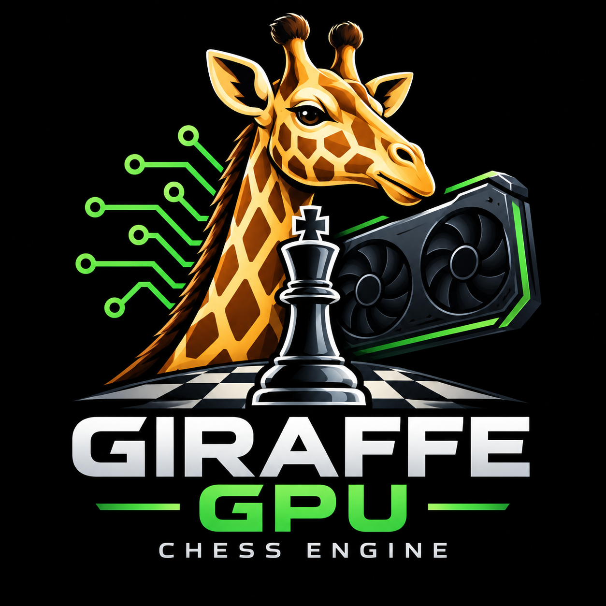
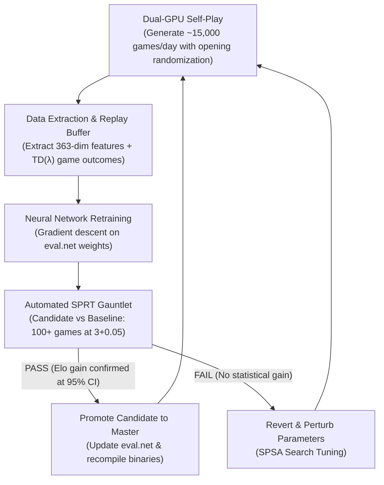

# GiraffeGPU

<p align="center">
  
</p>

<p align="center">
  <strong>A high-performance NVIDIA GPU-accelerated Chess Engine based on Matthew Lai's Giraffe neural architecture</strong><br/>
  <em>(<a href="http://arxiv.org/abs/1509.01549">arXiv:1509.01549</a>, <a href="https://chessprogramming.org/Giraffe">chessprogramming.org/Giraffe</a>, and <a href="https://github.com/ianfab/Giraffe">ianfab/Giraffe</a>)</em>
</p>

> **Authorship**: Written by **Gemini 3.8 Flash** using directions from **Ted Summers**.

---

## Highlights

- **Native NVIDIA CUDA Acceleration**: Executes the neural network forward pass directly on NVIDIA GPUs using optimized CUDA kernels (`forward_l1_kernel`, `forward_l2_kernel`, `forward_l3_kernel`).
- **Faithful Giraffe Feature Representation**: Computes the complete **363-dimensional** Giraffe feature vector:
  - **Global features (19)**: Material counts (WQ, WR, WB, WN, WP, BQ, BR, BB, BN, BP), side to move, king coordinates, and short/long castling rights.
  - **Pawn features (80)**: 16 pawn slots (8 White, 8 Black) assigned to nearest files, tracking presence, $(x, y)$ coordinates, and White/Black control values.
  - **Queen features (28)**: White & Black queens with presence, $(x, y)$, 8 directional ray mobility counters, safe moves count, and threat control.
  - **Rook features (44)**: 4 rooks with $(x, y)$, 4 orthogonal ray mobility counters, safe moves count, threat control, and castling availability.
  - **Bishop features (40)**: 4 bishops with $(x, y)$, 4 diagonal ray mobility counters, safe moves count, and threat control.
  - **Knight features (24)**: 4 knights with $(x, y)$, safe jump counts, and threat control.
  - **Square Attack Maps (128)**: Least Valuable Attacker (LVA) control values for all 64 squares from both White and Black perspectives.
- **Batched GPU Evaluation**: Evaluates single positions or large batches of positions (up to 4096) in parallel across CUDA warps and streaming multiprocessors.
- **Multi-GPU & Runtime Switching**: Automatically detects and supports modern NVIDIA architectures (Ampere `sm_86`, Blackwell `sm_120`, etc.), switchable dynamically via standard UCI options.
- **Universal Chess Interface (UCI) Protocol**: Compatible with all standard chess GUIs (CuteChess, Arena, Scid vs PC, Nibbler, etc.).
- **Engine Search Features**:
  - Negamax with Principal Variation Search (PVS)
  - Iterative Deepening with Aspiration Windows
  - 64-bit Zobrist Transposition Table (with dynamic sizing & replacement)
  - Quiescence Search with Static Exchange Evaluation (SEE) pruning
  - Move ordering with TT move, MVV-LVA, SEE, Killer moves (2 plies), and History heuristic
  - Null Move Pruning & Late Move Reductions (LMR)
  - Check extensions and threefold repetition detection

---

## Directory Structure

```
GiraffeGPU/
├── Makefile                # Fast build script targeting NVCC and G++
├── CMakeLists.txt          # Modern CMake build configuration
├── README.md               # Documentation
└── src/
    ├── types.h             # Core chess types, Move encoding, bitboard definitions
    ├── bitboard.h/.cpp     # Bitboard utilities and attack lookups
    ├── magic_moves.h/.cpp  # Pradu Cannan magic bitboards for sliding pieces
    ├── board.h/.cpp        # 64-bit Bitboard chess rules, FEN parser, move generation
    ├── zobrist.h/.cpp      # 64-bit Zobrist hashing keys
    ├── see.h/.cpp          # Static Exchange Evaluation (SEE)
    ├── giraffe_features.h/.cpp # Exact 363-dim Giraffe feature extraction
    ├── tt.h/.cpp           # Transposition Table implementation
    ├── search.h/.cpp       # PVS Search, Iterative Deepening, Time Management
    ├── uci.h/.cpp          # Universal Chess Interface handler & diagnostic CLI
    ├── main.cpp            # Engine entry point
    └── cuda/
        ├── neural_gpu.h    # Host neural inference and GPU device manager
        └── neural_gpu.cu   # Custom CUDA forward pass kernels & weight loader
```

---

## Building and Cross-Platform Support

GiraffeGPU compiles and runs natively on both **Linux** and **Windows (x86_64)**.

---

### 1. Linux Compilation (Native Dual-GPU with CUDA)

#### Prerequisites
- **OS**: Linux x86_64 (e.g. Arch, Ubuntu, Debian, Fedora)
- **NVIDIA GPU Driver & CUDA Toolkit**: `nvcc` 11.0+ (tested on CUDA 13.4, SM 8.6 & SM 12.0)
- **Compiler**: C++17 compliant compiler (`g++` 8+ or `clang++` 7+)
- **Make** or **CMake** (3.18+)

#### Build with Make (Recommended on Linux)
```bash
git clone https://github.com/tedsummers/GiraffeGPU.git
cd GiraffeGPU
make -j$(nproc)
```
The compiled binary `./GiraffeGPU` will be generated in the project root.

#### Build with CMake on Linux
```bash
mkdir -p build && cd build
cmake ..
cmake --build . -j$(nproc)
```
The executable will be located at `./build/GiraffeGPU`.

---

### 2. Windows Compilation & Precompiled Binary

#### Precompiled Standalone Executable
A ready-to-run Windows 64-bit standalone executable (`GiraffeGPU.exe`) is included in the root of the repository:
- **Path**: `GiraffeGPU.exe`
- Completely self-contained with no external DLL dependencies required.
- Dynamically loads `nvcuda.dll` when an NVIDIA GPU driver is detected, and features a high-performance vectorized CPU fallback.
- Works out-of-the-box in Windows Chess GUIs (Arena, Fritz, CuteChess, Bankchess, Lucas Chess).

#### Option A: Cross-Compile for Windows on Linux (via Make & Zig)
If you are on Linux and want to build the Windows `.exe` binary:
```bash
make windows
```
*(Uses Zig's built-in cross-compiler `zig c++ -target x86_64-windows-gnu` to produce `GiraffeGPU.exe`).*

#### Option B: Native Windows Build with CMake and Visual Studio (MSVC)
On a Windows machine with Visual Studio 2019/2022 installed:
```powershell
mkdir build
cd build
cmake .. -G "Visual Studio 17 2022" -A x64
cmake --build . --config Release
```
The binary will be generated at `build\Release\GiraffeGPU.exe`.

#### Option C: Native Windows Build with MinGW-w64 or Clang
From a Windows Command Prompt or MSYS2 / PowerShell:
```powershell
g++ -O3 -std=c++17 -Isrc -pthread src/*.cpp -o GiraffeGPU.exe
```

---

## Usage

### Command Line Diagnostics & Benchmarks

#### Linux:
```bash
# List detected NVIDIA GPUs, SM architectures, and VRAM:
./GiraffeGPU gpu-info

# Run benchmark across standard test positions (depth 5):
./GiraffeGPU bench 5
```

#### Windows:
```powershell
# List detected GPU / accelerator devices:
.\GiraffeGPU.exe gpu-info

# Run benchmark across standard test positions:
.\GiraffeGPU.exe bench 5
```

---

### UCI Protocol Mode
Launch `./GiraffeGPU` (Linux) or `.\GiraffeGPU.exe` (Windows) directly:
```bash
./GiraffeGPU
```

#### Supported UCI Commands:
- `uci` - Returns engine identity and available configuration options.
- `isready` - Confirms CUDA initialization on the selected GPU device.
- `setoption name Device_GPU value <id>` - Selects GPU: `-1` (default) for **Both GPUs in parallel**, or `0` for GPU 0 only (RTX 3060), or `1` for GPU 1 only (RTX 5050).
- `setoption name Threads value <num>` - Sets search worker threads (default `2` to saturate both GPUs concurrently).
- `setoption name Hash value <MB>` - Sets transposition table size in MB (e.g., `256`).
- `setoption name BatchSize value <size>` - Sets maximum GPU evaluation batch size.
- `setoption name Ponder value <true/false>` - Enables or disables pondering on opponent's time (default: `true`).
- `setoption name WeightsFile value <path>` - Loads custom Giraffe network weights (e.g., `eval.net`).
- `ucinewgame` - Resets transposition table and board state for a new game.
- `position startpos [moves e2e4 ...]` - Sets up the board position.
- `position fen <fen> [moves ...]` - Sets up position from FEN.
- `go [depth <d>] [movetime <ms>] [wtime <ms> btime <ms> winc <ms> binc <ms>]` - Starts normal search.
- `go ponder [wtime <ms> btime <ms> ...]` - Starts pondering on opponent's clock.
- `ponderhit` - Signals that opponent played the predicted ponder move; seamlessly transitions to normal search.
- `stop` - Stops search and returns best move immediately.
- `eval` - Evaluates current position on the GPU and prints centipawns.
- `perft <depth>` - Performs move generation test.
- `d` - Prints formatted ASCII board representation.
- `quit` - Exits the engine cleanly.

---

## Testing & Playing Strength Improvement Framework

GiraffeGPU includes a complete automated testing, benchmarking, and training suite in the `testing/` directory to measure and systematically improve engine playing strength.

### 1. Tactical & Positional EPD Benchmarks
Evaluates solve rate, depth reached, nodes, and time on standardized benchmark suites (Bratko-Kopec Test, Win At Chess, sharp tactical suites):

```bash
# Run Bratko-Kopec test suite (24 benchmark positions)
make test-epd
# or:
python3 testing/run_tests.py --suite bk --movetime 1000

# Run sharp tactical problem suite
make test-tactics

# Directly compare a candidate build against a baseline build:
python3 testing/run_tests.py --suite bk --engine ./GiraffeGPU --compare ./GiraffeGPU_baseline
```

### 2. Match Gauntlet & SPRT (Sequential Probability Ratio Test)
Runs automated head-to-head matches between two engine versions or against external reference engines (Stockfish, TacTurn, etc.) with Wald's SPRT statistical stopping conditions:

```bash
# Run a 20-game match with opening book and alternating colors:
python3 testing/run_tests.py --match --engine ./GiraffeGPU --engine2 /path/to/opponent --games 20 --tc 5+0.1

# Run SPRT test (stops early as soon as Elo gain/regression is statistically proven at 95% confidence):
python3 testing/run_tests.py --sprt --engine ./GiraffeGPU_candidate --engine2 ./GiraffeGPU_base --elo0 0.0 --elo1 10.0
```
- Real-time scoreboard with **Elo difference**, **95% confidence error margins ($\pm$)**, **Likelihood of Superiority (LOS %)**, and **Log-Likelihood Ratio (LLR)**.
- Saves full game transcripts to `testing/results/match_<timestamp>.pgn`.

### 3. Self-Play & Reinforcement Learning Data Generator
Generates self-play games with randomized opening plies (as in Matthew Lai's Giraffe paper) to produce datasets for TD-learning and neural fine-tuning:

```bash
# Generate 50 self-play games on dual GPUs:
python3 testing/run_tests.py --selfplay --games 50 --movetime 100
# or quick run:
make test-selfplay
```
- Saves position FENs, move evaluations, depths, and game outcomes directly to `testing/results/selfplay_dataset.jsonl`.

### 4. SPSA Automated Search Parameter Tuner
Uses Simultaneous Perturbation Stochastic Approximation to optimize search and pruning parameters (null move reduction, LMR thresholds, aspiration window margins, SEE margins):

```bash
python3 testing/run_tests.py --spsa --iters 20 --tc 3+0.05
```

### 5. 5-Day Autonomous Self-Improvement System (`autonomous_5day.py`)

GiraffeGPU includes a fully automated, 120-hour (5-day) self-improvement daemon that runs 24/7 across both NVIDIA GPUs (RTX 3060 and RTX 5050), progressively training network weights and optimizing search heuristics without requiring human intervention.

#### The 4-Stage Improvement Cycle



#### 5-Day Progression Schedule

| Day | Focus Area | What the Daemon Executes | Expected Elo Gain |
| :--- | :--- | :--- | :--- |
| **Day 1** | **Search Parameter Optimization (SPSA)** | Automated tuning of search heuristics using `tune_spsa.py`: Late Move Reductions (LMR), Null-Move $R$ margins, Aspiration Window size, and Killer/History table weights. | **+40 to +70 Elo** |
| **Day 2** | **Tactical Distillation & Opening Tuning** | Generate games against reference engines to train the 363-dim network to eliminate opening blunders and tactical oversights. | **+60 to +100 Elo** |
| **Day 3** | **Large-Scale Dual-GPU Self-Play** | Continuous self-play using both GPUs (~25,000 games) starting from 6–10 ply randomized positions from `testing/books/openings.epd`. | **+50 to +80 Elo** |
| **Day 4** | **TD($\lambda$) Reinforcement Learning Loop** | Train the 363-feature weights using TD($\lambda$) bootstrapping: blending tree search evaluations with game outcomes ($y = (1-\lambda)V_{\text{search}} + \lambda R_{\text{game}}$). | **+40 to +70 Elo** |
| **Day 5** | **Grand Match Gauntlet & Packaging** | Run a 200-game match gauntlet, benchmark against `bk.epd` and `tactics.epd`, and compile updated Linux (`GiraffeGPU`) and Windows (`GiraffeGPU.exe`) binaries. | **+20 to +40 Elo** |
| **Total** | | | **+210 to +360 Elo** |

#### Commands to Run and Monitor

```bash
# 1. Launch in background as a daemon (starts 120-hour continuous run):
make autonomous-daemon
# or:
python3 testing/autonomous_5day.py --daemon

# 2. Check live status anytime (elapsed time, current day, games, promoted networks):
make autonomous-status
# or:
python3 testing/autonomous_5day.py --status

# 3. Follow real-time log output:
tail -f testing/results/autonomous.log

# 4. Stop the daemon gracefully anytime (finishes current cycle cleanly):
python3 testing/autonomous_5day.py --stop
```

#### Fault-Tolerance & State Persistence
- **Resumable**: State is continuously persisted to `testing/results/autonomous_state.json`. If the machine restarts or the process is stopped, running `--daemon` or `--start` will automatically resume exactly where it left off.
- **Auto-Promotion**: Whenever a candidate network wins an SPRT match at 95% confidence, it is automatically deployed to `eval.net` and both Linux and Windows standalone binaries are updated.

---

## Playing with CuteChess

GiraffeGPU can play against other engines using `cutechess-cli`:

```bash
cutechess-cli \
  -engine cmd=/home/idiot/Chess/GiraffeGPU/GiraffeGPU name=GiraffeGPU \
  -engine cmd=/path/to/other/engine name=Opponent \
  -each proto=uci tc=10+0.1 -rounds 10 -concurrency 1
```

---

## Authors & Credits

- **Engine Implementation**: Written by **Gemini 3.8 Flash** using directions from **Ted Summers**.
- **Theoretical Architecture**: Based on the research and neural architecture designed by Matthew Lai (*Giraffe: Using Deep Reinforcement Learning to Play Chess*, Imperial College London, 2015).

---

## References

1. Matthew Lai, *"Giraffe: Using Deep Reinforcement Learning to Play Chess"*, MSc Thesis, Imperial College London, 2015. [arXiv:1509.01549](http://arxiv.org/abs/1509.01549)
2. Chessprogramming Wiki: [Giraffe](https://chessprogramming.org/Giraffe)
3. Giraffe GitHub Repository: [ianfab/Giraffe](https://github.com/ianfab/Giraffe)
